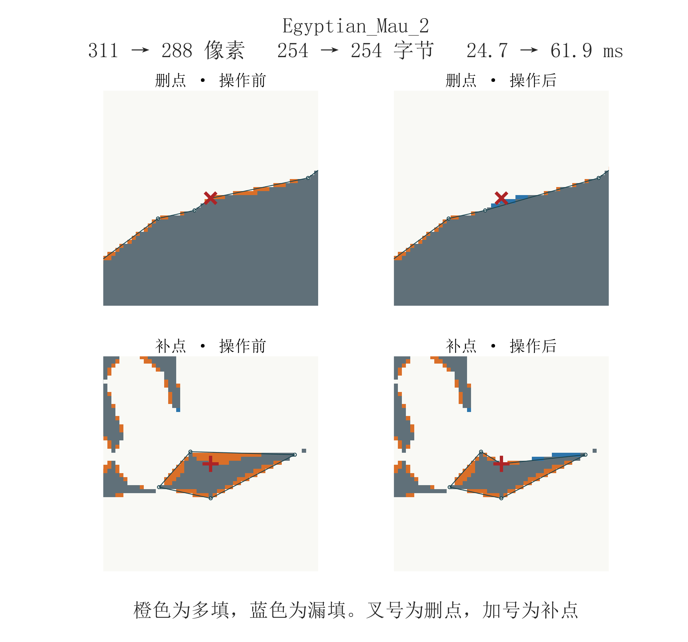

# 限时交付下保持部件与孔对应的二值蒙版多边形编码

一幅二值蒙版可以包含多个前景部件，部件内部还可能有孔。给定 **256 字节**和 **100 毫秒**，怎样用少量顶点描述这些轮廓，让接收者解码出的蒙版尽量接近原图，同时保住部件与孔之间的对应关系？本项目用 MATLAB 实现编码、解码和逐像素评价，比较顶点分配、轮廓简化和搜索速度对最终结果的影响。



图中 Egyptian_Mau_2 的两份文件均为 254 字节。一次调整从一个环删去一个顶点，把它补到另一个环，错分像素从 311 降至 288。不同图像上的效果有正有负，可查看[改善、持平和退化的实际文件](perf_results/output/figures/cases)。

## 先跑一个例子

实验环境为 MATLAB R2024a 和 Image Processing Toolbox 24.1。在仓库根目录执行以下代码即可编码、独立解码并显示一幅带孔的合成蒙版。这个例子无需下载数据，固定搜索轮数便于在不同机器上观察结果。

```matlab
addpath(genpath('src'), 'performance/kernel')
mask = false(48, 64);
mask(7:40, 8:54) = true;
mask(16:29, 23:39) = false;

[trial, events] = efMeasure(mask, 128, 'cross', Inf, 2);
assert(~isempty(events), '%s', trial.status)
bytes = events(end).bytes;
decoded = decodePM31(bytes);
score = pixelScores(mask, decoded);
fprintf('%d B, %d 个错分像素, IoU %.4f\n', numel(bytes), score.xor, score.iou)
imshowpair(mask, decoded, 'montage')
```

要观察时限，将第四个参数改为 `200`，在返回的事件中用 `find([events.received_ms] <= 100, 1, 'last')` 选取截止前最后收到的文件。索引为空表示该次调用在 100 毫秒内尚无可用文件。正式计时使用独立、预热过的单线程进程。

## 算法怎样工作

1. **从像素得到轮廓。** 在原尺寸蒙版上提取外环与孔的嵌套关系。PM31 文件保存图幅、父环编号和四分之一像素坐标，接收端仅凭文件即可回填蒙版。[轮廓提取](src/contours/extractRings.m) · [编码](src/codec/packPM31.m) · [解码](src/codec/decodePM31.m)
2. **把字节分给各个环。** 每个环至少保留三个顶点。对不同顶点数计算回填误差，用动态规划分配预算，再验证部件、孔和邻接关系，得到第一份可交付文件。[预算分配](src/allocation/allocateCounts.m) · [结构检查](src/topology/structureMatch.m)
3. **利用剩余时间降低误差。** `within_full` 只在同一个环上删插顶点，`cross` 还允许把一个顶点转给另一个环。程序对候选做整图回填和结构检查，只交付严格减少错分的合法更新。快速实现复用未变化环的计算，精确计算改边影响到的像素。[参考搜索](src/optimization/exchangeStep.m) · [快速搜索](performance/kernel/efStep.m) · [精确评价原理](docs/exactness_argument.md)

## 实验回答了什么

**基础实验**使用 200 个 Oxford 来源和 100 个外部 LEMS 形状。在 Oxford 多环、256 B、100 ms 条件下，145 个来源有 849 对及时且等长的文件。圈内减跨圈的平均错分差为 −0.115 像素，95% 区间为 [−1.234, 1.018]。延至 200 ms，148 个来源的平均差为 +3.084 像素。[基础实验结果](results/summary.csv) · [交付覆盖与失败](results/status_counts.csv)

**独立确认**另取 200 个 Oxford 来源，其中 48 个进入固定工作量计时子集。下表中，时间比越小表示越快；质量差取“对照方法错分数减去快速跨圈方法错分数”，正值表示快速跨圈方法少错。

| 问题 | 条件与有效配对 | 结果 |
| --- | --- | --- |
| 相同搜索工作能快多少？ | 48 源、288 对；比较跨圈法两种实现，逐轮文件相同 | 总耗时比 0.36246，减少 **63.75%**；双侧 97.5% 区间 [0.33835, 0.38798] |
| 同样加速后，跨圈比圈内少错吗？ | 多环、256 B、100 ms；150 源、881 对 | 平均 **−0.99 像素**；双侧 97.5% 区间 [−2.99, 0.87]，未能确认稳定增益 |
| 与几何简化相比如何？ | 256 B、100 ms；两项比较各 191 源、1,136 对 | 对纯几何平均少错 **90.06** 像素；对增加圈内优化的几何方法平均多错 **15.46** 像素 |

限时质量只比较同源、同会话、同次重复且及时等长的输出，再按来源等权汇总。完整覆盖表另计逾期和失败。上述耗时对应 Windows 11、Core Ultra 9 275HX 的单线程测量。[确认结果与区间](perf_results/output/formal_summary.md) · [详细实验分析](docs/optimization_results.md) · [逐源质量](perf_results/output/timed_by_source.csv) · [成功与失败计数](perf_results/output/timed_failures_and_success.csv) · [测量环境](docs/performance_environment.md)

## 阅读与复现

| 想做什么 | 入口 |
| --- | --- |
| 看一张图为何改善或退化 | [逐源效果图](perf_results/output/figures/04-source-effects.png)和[案例索引](perf_results/output/figures/cases/cases.csv)，同目录附输入、解码结果、错分图和实际 PM31 文件 |
| 核对表中两项主要结果 | 在 MATLAB 根目录执行 `addpath('scripts'); verify_primary_tables(pwd)`，使用仓库内的配对表重算源数、重复对数、点估计及区间 |
| 跑开发集测试 | 在 Windows PowerShell 执行 `./scripts/restore_data.ps1 -DevelopmentOnly`，再执行 `matlab -singleCompThread -batch "dip('test')"`。脚本按名单恢复 36 张开发标注并核验摘要 |
| 阅读或重做基础实验 | [样本与接收协议](docs/freeze_protocol.md) · [原始数据取得方式](docs/data.md) · [会话运行入口](scripts/run_sessions.ps1) · [逐次观测的字段](docs/observation_schema.md) |
| 阅读或重做精确评价实验 | [实验方案](docs/optimization_plan.md) · [运行方式](performance/README.md) · [等价性验证](docs/equivalence_validation.md) · [完整统计与图件](perf_results/output) |

正式实验的每次新计时都应使用独立目录。公开结果包含逐图观测、失败状态与案例；逐事件 JSONL 和全部 PM31 文件保存在本地实验归档。使用既有结果表核算时无须重新计时。[数据来源与署名](docs/attribution.md)
